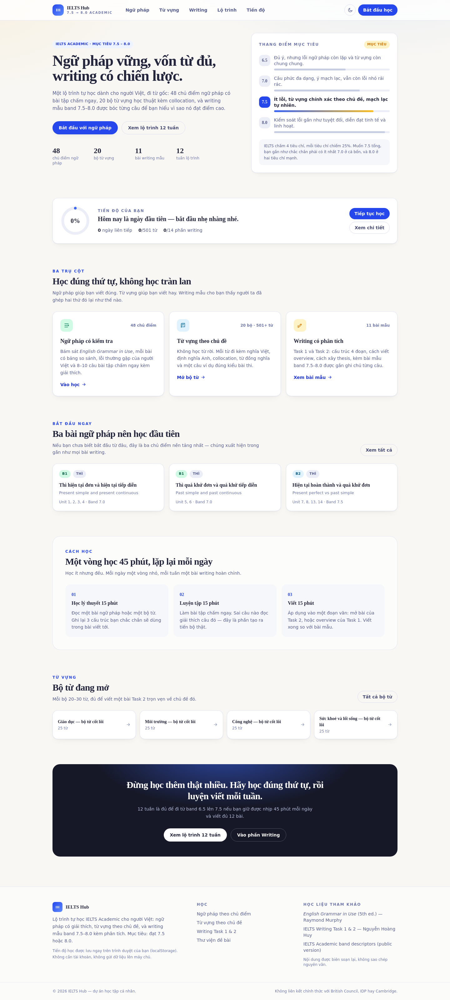
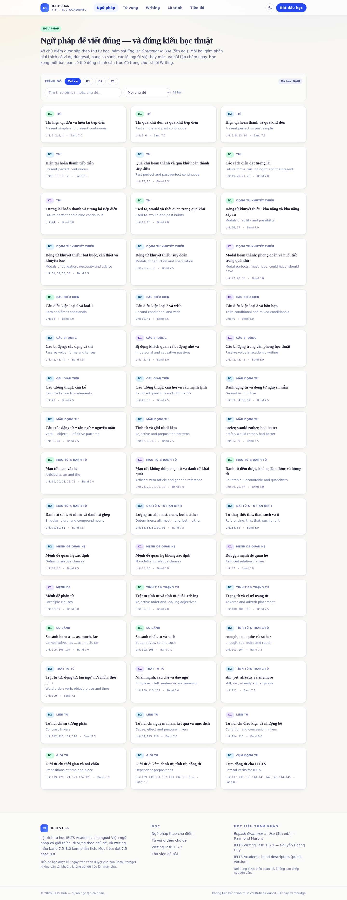
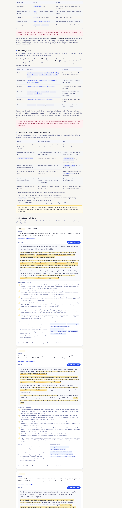

# IELTS Hub — Ngữ pháp, từ vựng và Writing cho mục tiêu 7.5–8.0

Web app tự học IELTS Academic, giao diện tiếng Việt, nội dung học bằng tiếng Anh. Toàn bộ nội dung là file JSON tĩnh trong `content/`, không có backend, không có tài khoản — tiến độ học nằm trong `localStorage` của trình duyệt.

**Nội dung hiện có**

| Phần | Số lượng |
| --- | --- |
| Bài ngữ pháp (có bài tập chấm điểm) | 48 bài, 480 câu hỏi |
| Bộ từ vựng theo chủ đề | 20 bộ, 501 từ (IPA, nghĩa Việt, ví dụ, collocation, họ từ) |
| Writing Task 1 | 8 phần lý thuyết + 5 bài mẫu band 7.5–8.0 có chú thích từng câu |
| Writing Task 2 | 8 phần lý thuyết + 6 bài mẫu band 8.0 có chú thích |
| Tiêu chí chấm (band descriptors) | 4 tiêu chí, giải nghĩa band 6 / 7 / 8 + thang điểm 5.5–8.5 |
| Thư viện đề | 23 đề (8 Task 1, 15 Task 2) kèm dàn ý, cấu trúc, cụm từ |
| Lộ trình | 12 tuần, chia 3 giai đoạn, kèm mốc kiểm tra |

Nguồn học liệu: *English Grammar in Use* (5th ed., Raymond Murphy) cho phần ngữ pháp; hai tài liệu IELTS Writing tiếng Việt (Nguyễn Hoàng Huy — Task 2, The Forum Center — Task 1) cho phần writing. Nội dung được biên soạn lại, không sao chép nguyên văn.

## Ảnh giao diện





## Chạy trên máy

```bash
npm install
npm run dev          # http://localhost:3000
```

Các lệnh khác:

```bash
npm run validate:content   # kiểm tra toàn bộ JSON trong content/
npm run typecheck          # tsc --noEmit
npm run build              # validate + next build (bắt buộc pass trước khi deploy)
npm start                  # chạy bản production đã build
```

Yêu cầu: Node 18.18+ (đã kiểm tra trên Node 25), npm 9+.

## Deploy lên Vercel

Repo đã có `vercel.json` nên Vercel tự nhận đúng framework, build command và region mặc định.

**Cách 1 — kéo GitHub về Vercel (khuyến nghị)**

1. Đẩy repo lên GitHub:
   ```bash
   git init && git add . && git commit -m "IELTS Hub"
   git remote add origin git@github.com:<tài-khoản>/<repo>.git
   git push -u origin main
   ```
2. Vào [vercel.com/new](https://vercel.com/new), chọn repo, giữ nguyên mọi thiết lập (Framework: Next.js), bấm **Deploy**.

**Cách 2 — dùng CLI**

```bash
npm i -g vercel
vercel          # deploy bản preview
vercel --prod   # deploy production
```

**Biến môi trường (tuỳ chọn)**

| Biến | Ý nghĩa |
| --- | --- |
| `NEXT_PUBLIC_SITE_URL` | URL công khai, dùng cho `metadataBase` và thẻ Open Graph. Ví dụ `https://ielts-hub.vercel.app`. Nếu bỏ trống sẽ mặc định `http://localhost:3000`. |

Không cần database, không cần API key. Toàn bộ site được render tĩnh (82 trang) nên chạy tốt trên gói miễn phí.

## Cấu trúc repo

```
app/                     # Next.js App Router
  page.tsx               # trang chủ
  grammar/               # danh sách + [slug] bài học có bài tập
  vocabulary/            # danh sách + [slug] bộ từ (3 chế độ học)
  writing/               # hub, task1, task2, band-descriptors, prompts
  plan/                  # lộ trình 12 tuần
  progress/              # tiến độ học
components/              # UI (client + server), trình soạn bài tập, flashcard…
lib/
  types.ts               # hợp đồng dữ liệu nội dung
  content.ts             # đọc JSON phía server (cache trong bộ nhớ)
  labels.ts              # nhãn tiếng Việt dùng được ở client
  progress.ts            # mô hình localStorage + hàm tổng hợp
content/
  manifest.json          # danh mục 48 bài ngữ pháp + 20 bộ từ vựng
  grammar/*.json         # 48 bài ngữ pháp
  vocabulary/*.json      # 20 bộ từ vựng
  writing/task1.json     # lý thuyết + 5 bài mẫu Task 1
  writing/task2.json     # lý thuyết + 6 bài mẫu Task 2
  writing/band-descriptors.json
  writing/prompts.json   # 23 đề luyện
  plan.json              # lộ trình 12 tuần
scripts/validate-content.mjs
sources/                 # PDF gốc + text trích xuất (không dùng lúc runtime)
```

## Thêm nội dung mới

1. Thêm mục vào `content/manifest.json` (slug, title, titleVi, level, topic, bookUnits, bandFocus).
2. Tạo file JSON tương ứng trong `content/grammar/` hoặc `content/vocabulary/` theo đúng schema ở `lib/types.ts` và `CONTENT_SPEC.md`.
3. Chạy `node scripts/validate-content.mjs --only content/grammar/<slug>` để kiểm tra riêng file vừa viết.
4. `npm run build` — trang mới tự xuất hiện vì mọi route dùng `generateStaticParams` đọc từ `manifest.json`.

Validator kiểm tra: schema, độ dài mục, mã band hợp lệ, trích dẫn trong bài mẫu Writing phải là chuỗi con nguyên văn của bài, `wordCount` lệch không quá 25 từ, slug trong lộ trình phải tồn tại.

## Ghi chú thiết kế

- **Không backend**: tiến độ (điểm bài tập, từ đã thuộc, bài mẫu đã đọc, chuỗi ngày) lưu ở `localStorage` key `ielts-hub-progress-v1`. Xoá dữ liệu trình duyệt là mất tiến độ; trên trang Tiến độ có nút xoá có xác nhận.
- **Dark mode** lưu ở `ielts-theme`, áp class `.dark` trước khi paint để không nháy trắng.
- **Không dùng `next/font`**: font hệ thống (serif cho tiêu đề, sans cho nội dung) để build chạy được trong môi trường không có mạng.
- Bài mẫu Writing được tô sáng câu ăn điểm bằng cách so khớp chuỗi `annotations[].quote` với bài viết, nên chú thích luôn khớp nội dung (validator chặn nếu lệch).

## Giấy phép và miễn trừ

Dự án học tập cá nhân, không liên kết với British Council, IDP hay Cambridge. Nội dung ngữ pháp dựa trên *English Grammar in Use* của Raymond Murphy nhưng được diễn giải lại bằng ví dụ riêng; band descriptors được diễn giải lại bằng tiếng Việt.
